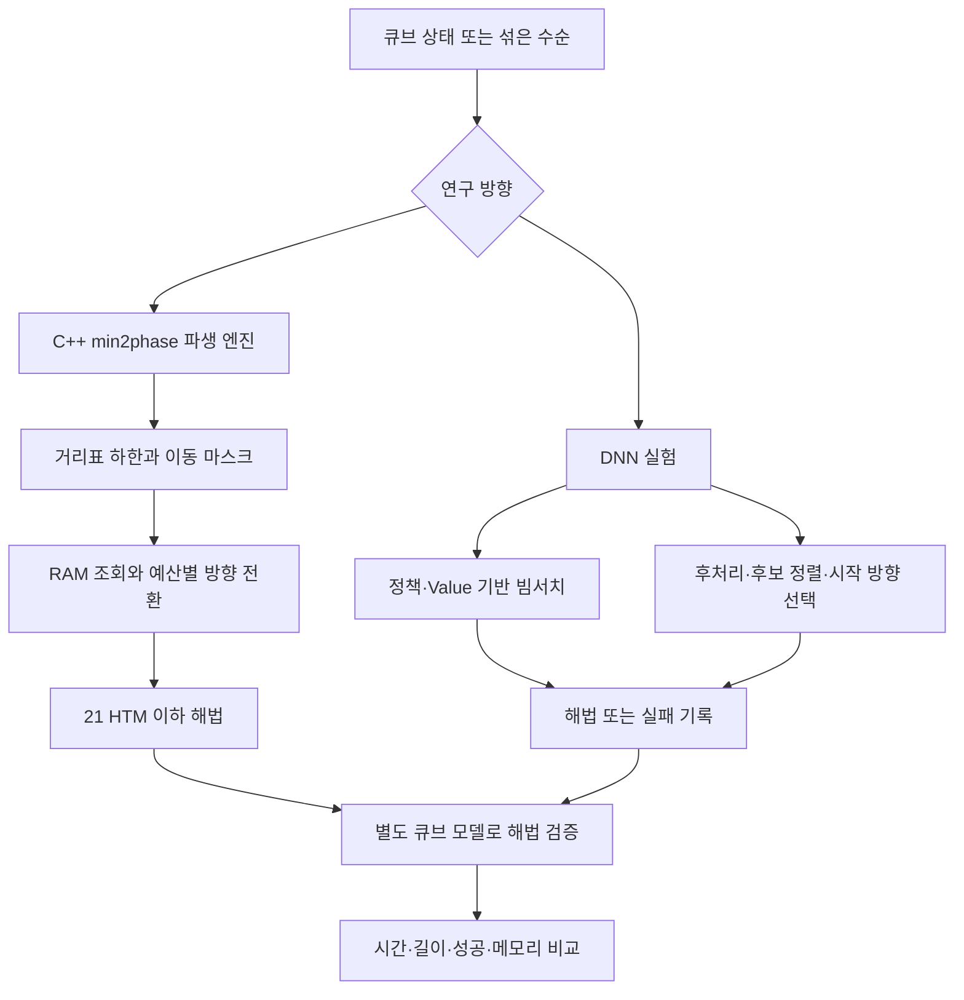

# Cube Solver — C++ 최적화와 DNN 실험

3×3×3 루빅스 큐브 솔버의 **탐색 속도와 해법 길이를 개선하기 위해 진행한 C++·DNN 실험**을 정리한 프로젝트입니다.

C++에서는 min2phase 계열 엔진에 Rob 유래 거리표를 연결하고, 이동 마스크·RAM 전개·탐색 방향 전환을 적용했습니다. DNN에서는 AlphaCube 후처리부터 자체 Policy+Value 모델, Phase 2 후보 정렬, 초소형 시작 방향 선택까지 비교했습니다.

**C++은 실제 풀이 시간 단축을 확인했습니다. DNN은 자체 모델의 해결 수를 늘렸지만, 이번 CPU 실험에서 기존 min2phase보다 일관되게 좋은 솔버를 만들지는 못했습니다.**

이 폴더는 GitHub에 올릴 요약 문서와 기존 실험 보고서 모음입니다. 실행 소스·가중치·대형 거리표는 포함하지 않습니다. 문서 정리일은 2026-11-17이며, 아래 수치는 기존 실험 기록을 인용한 값입니다.

<details>
<summary>목차</summary>

1. [프로젝트 목표](#1-프로젝트-목표)
2. [핵심 결과](#2-핵심-결과)
3. [개발 환경](#3-개발-환경)
4. [전체 동작 구조](#4-전체-동작-구조)
5. [직접 구현한 부분](#5-직접-구현한-부분)
6. [실험 과정과 문제 해결](#6-실험-과정과-문제-해결)
7. [검증 방법과 한계](#7-검증-방법과-한계)
8. [문서 구성](#8-문서-구성)
9. [배운 점과 후속 과제](#9-배운-점과-후속-과제)
10. [참고 프로젝트와 출처](#10-참고-프로젝트와-출처)

</details>

## 1. 프로젝트 목표

큐브를 푸는 프로그램에서 다음 두 가지를 확인하고자 했습니다.

| 방향 | 질문 | 비교 기준 |
|---|---|---|
| C++ 탐색 최적화 | 더 강한 거리 정보와 조회 방식 변경으로 불필요한 탐색을 줄일 수 있을까? | 평균·P95·P99 풀이 시간, 초기화, 메모리, 배치 처리량 |
| DNN 결합 | 신경망이 다음 회전이나 유망한 탐색 순서를 골라 기존 솔버를 개선할 수 있을까? | 실제 해결 수, 해법 길이, 추론을 포함한 전체 풀이 시간 |

min2phase·Rob·AlphaCube는 외부 프로젝트입니다. 이번 작업은 이 기반 위에 거리표 변환, 탐색 변경, 모델 학습·추론 연결, 비교 도구와 독립 검증을 추가한 것입니다.

## 2. 핵심 결과

### 2.1 C++: 거리표 개선에서 느린 입력 최적화까지

| 실험 | 비교 | 결과 |
|---|---|---|
| 거리표·이동 마스크·RAM 전개 | 기존 `ram` → `max`, 같은 1스레드 | 평균 **0.2705 → 0.1163ms**, 57.0% 단축 |
| 동일 정보를 저장하는 방식 | `masks` → `max`, 같은 1스레드 | 평균 **0.1224 → 0.1163ms**, 5.0% 단축 |
| 큐브 간 병렬 배치 | 기존 `ram` → `max`, 각각 8스레드 | **18,341 → 48,943개/초**, 2.67배 |
| 후속 Tail 최적화 | 기존 `max` → `tail`, 새 입력·같은 1스레드 | 평균 **0.2363 → 0.1030ms**, P95 **0.8867 → 0.2961ms** |

거리표 비교와 Tail 비교는 입력·실행 시점이 다른 실험입니다. 각 행의 짝지은 비교를 기준으로 읽어야 합니다. 57.0%에는 강한 하한과 이동 마스크의 효과가 포함되며, RAM을 크게 펼친 효과만을 뜻하지 않습니다.

`max`는 공유 조회표 약 10.86GiB와 초기화 비용을 사용합니다. Tail 비교에서는 평균 해 길이가 20.542 → 20.630 HTM으로 늘었고, 모든 결과는 21 HTM 이하였습니다. 속도와 해 길이의 교환도 함께 확인했습니다.

근거: [거리표 최종 비교](benchmarks/cpp-max/REPORT.md) · [Tail 최종 비교](benchmarks/cpp-tail/REPORT.md). 구현 설명과 Rob 비교는 [C++ 상세 문서](docs/CPP.md)에 있습니다.

### 2.2 DNN: 자체 개선과 기준선 대비 개선을 구분

| 실험 | 관측 결과 | 결론 |
|---|---|---|
| AlphaCube 전체 재탐색 | 30개 평균 **17.900 → 16.100 HTM** | 같은 요청 예산의 min2phase 추가 탐색은 **15.167 HTM** |
| 독립 Policy+Value 솔버 | 같은 100개에서 **26 → 47개 해결** | min2phase는 100개 해결; 3회 모두 시간 내 성공한 입력 기준 |
| Phase 2 DNN 후보 정렬 | 첫 해 중앙값 **0.5121 → 0.8317ms** | 후보 수집·특징 생성·추론·정렬 비용을 상쇄하지 못함 |
| 초소형 DNN 학습량 확대 | 3천·1만·3만 학습에서 평균 **1.2974 / 1.2972 / 1.3059ms** | 같은 테스트의 원본 **1.2949ms**, 일관된 개선 추세 없음 |

각 행은 서로 다른 표본과 실험 조건입니다. DNN 정렬 실험은 Java min2phase를 사용하므로 위 C++ 결과와 절대 시간을 직접 비교하지 않습니다.

근거와 조건: [DNN 상세 문서](docs/DNN.md).

## 3. 개발 환경

| 구분 | 사용 기술 |
|---|---|
| C++ 엔진·도구 | C++17, GCC, O3/LTO, CMake, Python 측정 도구 |
| DNN 학습·실험 | Python, PyTorch, NumPy, CPU 추론 |
| DNN 비교 기준·검증 | Java min2phase, JDK, 별도 큐브 회전 모델 |
| 실행 환경 | Windows 로컬 환경; 세부 조건은 실험별 보고서 참조 |
| C++ 거리표 최종 비교 장비 | Intel Core Ultra 5 228V, 논리 CPU 8개, 물리 RAM 약 32GB |

공개용 C++ 패키지에는 CLI, JSON Lines 상주 호출, C++ API, Python 연결 예제와 Windows wheel을 구성했습니다. 실제 검증된 소스 빌드는 Windows GCC이며, MSVC는 현재 지원하지 않습니다. 사용법 원문은 [공개 패키지 안내](docs/CPP_USAGE.md)에 있습니다.

## 4. 전체 동작 구조

아래는 두 연구 방향을 설명하는 개념도입니다. C++와 DNN을 모두 한 번에 실행하는 단일 제품 구조를 뜻하지 않습니다.



## 5. 직접 구현한 부분

| 분야 | 추가한 작업 |
|---|---|
| 거리표 연결 | min2phase와 Rob 사이의 좌표·회전·대칭 표현 변환 |
| C++ 가지치기 | Phase 1 이동 마스크와 Phase 2 결합 하한 연결 |
| 저장 방식 | 압축 조회 `masks`와 원시 좌표 RAM 조회 `max` 비교 |
| 느린 입력 대응 | 512 → 2,048노드 선행 탐색과 방향 전환, 기존 탐색 복귀 |
| 공개용 인터페이스 | 명령줄, 상주 JSONL, C++ API, Python 연결과 패키징 |
| DNN 후처리 | 전체 재탐색·구간 교체, 기존 유효 해법 유지 |
| 학습·탐색 | 교사 데이터 생성, 자체 Policy+Value 모델, 빔서치·정답표·재시도 |
| 순서 선택 | Phase 2 후보 정렬, 시작 방향 선택, 학습량별 대조 실험 |
| 실험 기반 | 입력 분리, 반복 측정, 독립 해법 재생, 결과·해시 기록 |

외부 알고리즘과 사전학습 모델의 기여는 [출처 문서](docs/SOURCES.md)에 구분했습니다.

## 6. 실험 과정과 문제 해결

| 문제 | 대응 | 확인한 점 |
|---|---|---|
| 솔버마다 같은 상태의 좌표 번호가 다름 | 좌표·대칭·회전 변환을 만들고 기존 조회와 대조 | 표를 연결하려면 상태 표현의 일치부터 검증해야 함 |
| 큰 표를 쓰면 무조건 빠를 것이라는 예상 | 단일 요청·race·배치를 따로 측정 | `max`는 배치에서 유리했지만 8스레드 race는 `masks`보다 느렸음 |
| 일부 방향에서 탐색이 길어짐 | 짧은 노드 예산으로 여러 방향을 시도한 뒤 기존 탐색으로 복귀 | Tail 비교에서 P95·P99와 1ms 초과 입력 수 감소 |
| 다음 회전 정확도 상승이 해결률 상승으로 이어지지 않음 | 분류 정확도와 실제 큐브 해결 수를 별도 평가 | 추가 학습 전후 57/60개로 동일 |
| DNN이 탐색 호출을 줄여도 시간이 늘어남 | 후보 수집·특징·추론·정렬까지 측정 | 호출 수만으로 실제 속도를 판단할 수 없음 |
| 첫 해만 비교하면 후처리가 유리해 보임 | min2phase 자체 추가 탐색을 대조군에 포함 | DNN 후처리의 단축과 기준선 우위를 구분 |

## 7. 검증 방법과 한계

- **해법 검증:** 출력 수순을 별도 큐브 모델에서 재생해 완성 상태인지 확인했습니다. 거리표 최종 비교는 8,477개 고유 입력·해법 쌍을 검증했습니다.
- **표 검증:** 기존 거리값과 새 조회값을 대조하고, 이동 마스크와 확장 조회를 검사했습니다. 대형 표의 모든 이동을 전수 검사한 것은 아닙니다.
- **평가 분리:** 개발용·검증용·새 테스트 입력을 구분했습니다. 같은 큐브의 반복 실행을 서로 다른 큐브로 세지 않았습니다.
- **시간 범위:** 초기화·통신·파일 출력의 포함 여부는 실험별로 명시했습니다. 주로 예열 후 엔진 내부 시간을 비교했습니다.
- **해석 범위:** C++은 최단해를 보장하지 않습니다. 독립 DNN 빔서치는 해결도 보장하지 않습니다. CPU·입력 분포·예산이 다른 결과를 하나의 순위로 합치지 않았습니다.

## 8. 문서 구성

```text
cube_github_summary/
├── README.md                  # 프로젝트 전체 요약
├── docs/
│   ├── CPP.md                 # C++ 거리표·Tail 최적화 상세
│   ├── CPP_USAGE.md           # 기존 공개용 패키지 사용 안내
│   ├── DNN.md                 # DNN 실험과 실패 원인 분석
│   └── SOURCES.md             # 외부 출처·원자료 위치·포함 범위
└── benchmarks/
    ├── cpp-max/               # 거리표 최종 비교
    ├── cpp-tail/              # Tail과 기존 max 비교
    ├── cpp-tail-vs-rob/       # Tail과 Rob 원본 비교
    ├── dnn-postprocess/       # AlphaCube 후처리
    ├── dnn-teacher/           # 추가 학습
    ├── dnn-standalone/        # 독립 솔버 v2
    ├── dnn-ranking/           # Phase 2 후보 정렬
    ├── dnn-quality/           # 고정 시간 품질·메모리
    └── dnn-scale/             # 학습량 확대
```

벤치마크 폴더의 `REPORT.md`는 기존 보고서를 보존한 파일입니다. 보고서 안에 나오는 전체 소스·원시 결과 파일은 이 요약본에 모두 들어 있지는 않습니다.

## 9. 배운 점과 후속 과제

거리표를 강하게 만들면 방문할 상태는 줄일 수 있지만, 조회 비용과 메모리 사용량이 함께 늘어납니다. DNN도 마찬가지로 더 나은 후보를 골라도 추론과 정렬에 드는 시간이 크면 전체 풀이가 느려졌습니다. 그래서 최적화의 목표를 단일 숫자보다 실제 사용 방식에 맞춰 판단하게 됐습니다.

다음 과제는 메모리 제약을 맞춘 비교, 초기화까지 포함한 첫 응답 시간 측정, 느린 입력의 회귀 원인 분석입니다. DNN은 같은 구조에 데이터만 더 넣는 것보다 입력 특징·학습 목표를 분리해서 바꾸고, 실제 해결 수와 전체 실행 시간으로 검증할 필요가 있습니다.

## 10. 참고 프로젝트와 출처

- 문서 구성 참고: [Cube-Solver-Dev](https://github.com/P0doDang/PodoDang-suGar/tree/main/Cube-Solver-Dev), [위니브 프로젝트 샘플](https://github.com/weniv/project_sample_repo)
- C++ 기반: [min2phaseCXX](https://github.com/lilborgo/min2phaseCXX), [Rob two-phase](https://github.com/efrantar/rob-twophase)
- Java 비교 기준: [min2phase](https://github.com/cs0x7f/min2phase)
- AlphaCube의 정확한 배포 출처와 사용 범위, 코드 재배포 조건은 [출처 문서](docs/SOURCES.md)를 참고하세요.

참고 저장소의 실험 수치·개발 환경·기여 내용을 이번 작업의 결과로 사용하지 않았습니다.
