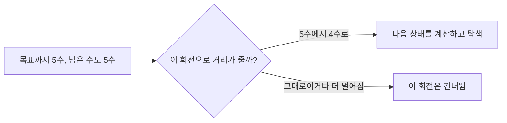

# 3×3 큐브를 더 빨리, 더 짧게 풀어 보기

같은 큐브를 min2phase는 처음에 15수로 풀었고, 신경망 솔버인 AlphaCube는 10수로 풀었습니다. 두 풀이를 직접 돌려 보니 모두 큐브가 맞았습니다. 다른 큐브에서도 다섯 수씩 줄일 수 있을까 궁금했습니다. 그런데 비교를 해 보려니 한 가지가 걸렸습니다. AlphaCube에 한 번 더 기회를 줬다면, min2phase에도 그만큼 시간을 줘야 공평하지 않을까요?

> **English summary.** I tried two ways to improve a 3×3 cube solver. In C++, I used pruning tables and changed when the search switches direction. On 2,000 test cubes, the number taking over 1 ms fell from 84 to 15. In a separate 30-cube experiment, AlphaCube shortened the first solutions, but continuing the original search produced shorter solutions on average.

[C++ 실험기](docs/CPP.md) · [DNN 실험기](docs/DNN.md) · [실험 보고서 9편](docs/SOURCES.md#실험별-보고서)

<details>
<summary>목차 펼치기</summary>

1. [프로젝트 소개](#1-프로젝트-소개)
2. [저장소 구성](#2-저장소-구성)
3. [개발 환경](#3-개발-환경)
4. [시작하기](#4-시작하기)
5. [동작 원리](#5-동작-원리)
6. [실험 결과](#6-실험-결과)
7. [만난 문제와 해결](#7-만난-문제와-해결)
8. [한계와 앞으로](#8-한계와-앞으로)
9. [출처와 라이선스](#9-출처와-라이선스)

</details>

## 1. 프로젝트 소개

큐브에서는 ‘좋은 풀이’가 두 가지 뜻을 가질 수 있습니다. 손으로 따라 할 때는 돌리는 횟수가 적은 게 좋고, 프로그램에 큐브를 넣고 답을 기다릴 때는 첫 풀이가 빨리 나오는 게 좋습니다. 그래서 두 가지를 각각 실험해 봤습니다.

| 궁금했던 점 | 직접 해 본 일 | 결과 |
|---|---|---|
| 신경망이 처음 찾은 풀이를 더 줄일 수 있을까? | 같은 큐브 30개를 AlphaCube로 다시 풀고, min2phase도 탐색을 이어 가게 했습니다. | AlphaCube는 14개, min2phase 추가 탐색은 23개에서 더 짧은 풀이를 찾았습니다. |
| C++ 솔버가 답을 낼 때까지 어디서 시간을 줄일 수 있을까? | Rob 솔버의 거리표를 연결해 불필요한 회전을 걸렀고, 한 방향을 오래 탐색하면 다른 방향을 먼저 보게 했습니다. | 방향 전환을 시험한 새 큐브 2,000개에서 풀이 시간이 1 ms를 넘긴 경우가 84개에서 15개로 줄었습니다. |

## 2. 저장소 구성

```text
cube-solver-research/
├── README.md
├── docs/
│   ├── CPP.md         C++ 거리표를 연결하고 탐색 순서를 바꾼 과정
│   ├── DNN.md         신경망에 맡긴 일과 실험별 결과
│   ├── CPP_USAGE.md   별도 C++ 패키지의 명령줄·API 사용 예시
│   └── SOURCES.md     기반 프로젝트와 실험 보고서 목록
└── benchmarks/         C++ 보고서 3편과 DNN 보고서 6편
```

## 3. 개발 환경

| 실험 | 사용한 환경 |
|---|---|
| C++ 거리표·탐색 비교 | Windows, C++17, GCC. 거리표 최종 비교에는 Intel Core Ultra 5 228V와 RAM 32 GB를 사용했습니다. |
| DNN 학습·평가 | Python, PyTorch, NumPy. CPU에서 모델을 돌리고 Java 버전 min2phase와 비교했습니다. |

## 4. 시작하기

**실제 큐브로 15수와 10수를 비교해 볼 수 있습니다.** 완성된 큐브에서 아래 ‘섞기’를 왼쪽부터 따라 한 뒤 풀이 하나를 적용합니다. 다른 풀이를 시험할 때도 완성 상태에서 똑같이 섞어 주세요. `U`, `D`, `L`, `R`, `F`, `B`는 각각 위·아래·왼쪽·오른쪽·앞·뒤 면입니다. 해당 면을 정면에서 봤을 때 글자만 있으면 시계 방향으로 90도, `'`가 붙으면 반대 방향으로 90도, `2`가 붙으면 180도 돌립니다.

| 실험 입력 `case-001` | 수순 |
|---|---|
| 섞기 | `D L' U' D2 F2 R' D2 B2 D2 B` |
| min2phase의 첫 풀이 · 15수 | `F' U2 B' F' R2 U2 F2 U2 R2 D2 L' B2 U' L D'` |
| AlphaCube로 다시 찾은 풀이 · 10수 | `B' D2 B2 D2 R F2 U D2 L D'` |

이 글에서는 90도든 180도든 한 면을 한 번 돌리면 1수로 셉니다. 이 기준을 HTM이라고 합니다. 두 수순 모두 실험 때 별도 회전 프로그램으로 재생해 완성 상태를 확인했습니다. C++ 실행 패키지를 가지고 있다면 명령줄에 섞기 수순을 입력하는 예제도 볼 수 있습니다. [실제 수순 기록](benchmarks/dnn-postprocess/REPORT.md) · [C++ 패키지 사용법](docs/CPP_USAGE.md)

## 5. 동작 원리

### C++에서 어떤 회전을 미리 거를 수 있을까?

min2phase는 먼저 조각의 방향과 중간층 엣지의 위치를 맞추고, 거기서 나머지 조각을 맞춥니다. 첫 단계의 목표까지 다섯 수가 필요하고 쓸 수 있는 수도 딱 다섯이라고 해 보겠습니다. 큐브를 한 번 돌렸는데 여전히 다섯 수가 필요하다면, 남은 네 수로는 그 길을 끝까지 갈 수 없습니다.

Rob의 거리표에서 마음에 들었던 부분이 여기였습니다. **어떤 회전을 하면 거리가 줄어드는지**를 표에서 읽을 수 있었습니다. 저는 그 정보를 min2phaseCXX에 연결해서, 가능성이 남은 회전만 다음 상태를 계산하도록 바꿨습니다. 그림은 남은 수가 빠듯할 때 한 경로를 검사하는 예입니다.



### 신경망에는 어떤 일을 맡겼나?

한 실험에서는 min2phase의 첫 풀이를 보관한 뒤 AlphaCube로 처음부터 다시 풀어 봤습니다. 15수짜리 풀이가 이미 있으면 새로 찾을 범위는 14수까지입니다. 다른 실험에서는 직접 학습한 모델이 다음에 돌릴 면을 추천하게 했습니다. 추천 한 개만 계속 따라가면 몇 수 뒤에 막힐 수 있어서 유망한 경로를 여러 개 남겨 뒀습니다. 이 방법이 **빔서치**입니다. 다음 버전에서는 각 경로에서 앞으로 몇 수쯤 더 필요할지도 예측해, 어느 경로를 남길지 정할 때 썼습니다. [DNN을 붙인 위치와 탐색 방법](docs/DNN.md)

## 6. 실험 결과

### 같은 시간 예산을 주면 누가 더 짧게 풀었나?

10회, 20회, 25회 섞은 큐브를 각각 10개씩 준비했습니다. 첫 풀이가 나온 뒤 각 방법에 3초의 예산을 줬습니다. 더 짧은 풀이를 찾으면 바꾸고, 못 찾으면 첫 풀이를 그대로 썼습니다.

| 큐브 30개에서 비교한 방법 | 평균 회전 수 | 첫 풀이보다 짧아진 큐브 |
|---|---:|---:|
| min2phase의 첫 풀이 | 17.90수 | — |
| AlphaCube로 전체를 다시 풀기 | 16.10수 | 14개 |
| AlphaCube로 풀이의 일부 구간 바꾸기 | 17.67수 | 2개 |
| min2phase로 탐색을 이어 가기 | **15.17수** | **23개** |

AlphaCube로 다시 풀자 30개를 합쳐 54수가 줄었습니다. 그런데 min2phase에 탐색을 계속 맡기자 82수가 줄었습니다. 실제로 쓴 추가 시간은 각각 평균 1.21초와 2.08초였습니다. 처음에 본 다섯 수 차이만으로는 알 수 없었던 부분입니다. [후처리 비교 보고서](benchmarks/dnn-postprocess/REPORT.md)

직접 만든 모델에서는 **끝까지 푼 큐브 수**를 봤습니다. 새 큐브 100개를 세 번씩 시도했을 때, 세 번 모두 성공한 큐브가 이전 모델의 26개에서 새 모델의 47개로 늘었습니다. 학습 데이터와 탐색 방식이 함께 바뀌었기 때문에 남은 수 예측의 효과도 따로 확인했습니다. 후보 수와 재시도 조건을 맞추고 그 예측값만 빼자 38개였습니다. 같은 입력을 min2phase는 100개 모두 풀었습니다. 자체 모델의 탐색 예산은 0.5초였고, min2phase는 첫 풀이가 나올 때까지 돌렸습니다. [독립 모델 비교 보고서](benchmarks/dnn-standalone/REPORT.md)

### 거리표를 크게 만들면 얼마나 빨라졌나?

무작위 큐브 상태 2,000개를 한 스레드로 하나씩 풀었습니다. 먼저 표를 메모리에 올리고 300개를 풀어 예열한 뒤, 엔진 안에서 풀이에 걸린 시간을 쟀습니다.

| C++ 버전 | 공유 거리표 크기 | 평균 풀이 시간 |
|---|---:|---:|
| `ram` · 기존 거리표 | 150.19 MiB | 0.2705 ms |
| `masks` · 시도할 회전과 두 번째 단계의 거리 정보 추가 | 795.68 MiB | 0.1224 ms |
| `max` · 같은 정보를 현재 좌표로 바로 읽도록 RAM에 펼침 | 10.86 GiB | 0.1163 ms |

처음과 끝을 비교하면 평균 시간이 57% 줄었습니다. 그런데 가운데 행을 보면 어디서 빨라졌는지가 보입니다. 시도할 회전을 거르고 두 번째 단계의 거리표를 더한 시점에 이미 0.1224 ms였습니다. 그 표를 10.86 GiB로 펼쳐서 더 줄인 시간은 약 5%였습니다. [거리표 비교 보고서](benchmarks/cpp-max/REPORT.md)

평균이 줄고 나니 유독 오래 걸리는 큐브들이 눈에 들어왔습니다. 그래서 한 방향에서 해를 오래 찾기 전에 다른 방향도 짧게 시도하도록 바꿨습니다. 이 버전을 `tail`이라고 불렀습니다. **별도로 뽑은 새 큐브 2,000개**에서 기존 `max`와 `tail`을 다시 비교하니, 1 ms가 넘게 걸린 큐브가 **84개에서 15개**로 줄었습니다. 먼저 발견하는 풀이가 달라져 평균 회전 수는 20.542수에서 20.630수로 조금 늘었습니다. [느린 입력의 풀이 시간과 회전 수](benchmarks/cpp-tail/REPORT.md)

## 7. 만난 문제와 해결

**같은 큐브인데 두 프로그램에서 번호가 달랐습니다.** Rob의 거리표를 가져와도 min2phase가 쓰는 번호로 곧바로 읽을 수는 없었습니다. 먼저 조각의 방향과 위치를 기준으로 두 번호가 어떻게 대응하는지 맞췄습니다. 그런 다음 양쪽에서 같은 면을 돌려 실제 조각이 같은 위치로 가는지 확인했습니다. 최종 비교에서는 서로 다른 입력과 풀이 8,477쌍을 별도 큐브 모델에서 재생했고 모두 완성됐습니다. [C++ 구현과 검증 과정](docs/CPP.md)

**신경망이 고른 순서대로 탐색하니 오히려 늦어졌습니다.** 후보를 모은 순서대로 처리할 때보다 신경망으로 정렬할 때 두 번째 단계의 탐색 호출은 줄었습니다. 어디서 시간이 드는지 보려고 ‘모으기만 한 경우’도 따로 쟀습니다. 첫 풀이까지 걸린 시간의 중앙값은 원본 0.5121 ms, 후보를 모으기만 하면 0.7772 ms, 신경망으로 정렬하면 0.8317 ms였습니다. 다음 실험에서는 후보를 모을 때마다 점수를 매기는 대신, 큐브를 풀기 직전에 시작 방향만 골라 봤습니다. [후보 정렬 실험](benchmarks/dnn-ranking/REPORT.md) · [시작 방향 선택 실험](benchmarks/dnn-scale/REPORT.md)

## 8. 한계와 앞으로

제가 이 솔버를 쓴다면 큐브를 몇 개 풀 건지부터 생각할 것 같습니다. 큰 표를 쓰는 `max`는 한 번 준비해 두면 8스레드로 초당 약 4만 9천 개를 처리했습니다. 하지만 한 스레드로 그 표를 준비하는 데만 약 12초가 걸렸습니다. 큐브 하나를 넣고 바로 답을 보고 싶은 상황에서는 그 12초가 훨씬 크게 느껴집니다. 다음에 비교한다면 프로그램을 켠 순간부터 첫 풀이가 화면에 뜰 때까지도 재 보고 싶습니다.

직접 학습한 DNN에는 특히 어려운 입력이 남았습니다. 20회 섞은 큐브 25개에서는 새 모델도 하나도 풀지 못했습니다. 다음에는 그런 큐브에서 유망한 경로가 몇 번째 회전에서 후보 밖으로 밀리는지 따라가 보고 싶습니다. [섞기 횟수별 결과](benchmarks/dnn-standalone/REPORT.md)

## 9. 출처와 라이선스

C++ 탐색은 min2phaseCXX를 바탕으로 했고, 거리 정보는 Rob에서 가져왔습니다. DNN 후처리에는 AlphaCube의 사전학습 모델을 썼습니다. 제가 작업한 부분은 두 솔버 사이의 표 변환, 탐색 순서 변경, 자체 모델 학습, 비교와 검증입니다. C++ 파생 패키지는 GPL-3.0-or-later를 따르고 AlphaCube 원본은 MIT 라이선스를 따릅니다. 기반 프로젝트의 링크와 실험에 사용한 버전은 출처 문서에 모았습니다. [프로젝트별 출처와 라이선스](docs/SOURCES.md)
