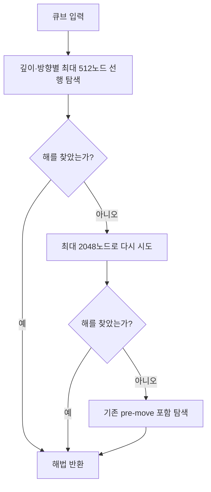

# C++ 큐브 솔버: 거리표 연결과 탐색 최적화

[전체 요약으로 돌아가기](../README.md)

min2phase 계열 C++ 탐색을 기반으로 Rob의 거리 정보를 변환해 연결하고, 메모리 조회 방식과 탐색 순서를 개선했습니다. 최신 후속 작업은 느린 입력을 줄이는 Tail 최적화와 공개용 API·CLI 구성입니다.

## 1. 목표와 기본 원리

큐브 솔버는 현재 상태에서 적어도 몇 수가 필요한지 알려 주는 거리표를 사용합니다. 남은 깊이가 4인데 하한이 6이면 해당 경로를 더 볼 필요가 없습니다. 이번 작업의 목표는 더 강한 하한을 읽고, 불필요한 회전을 좌표 계산 전에 제외하고, 특정 방향에 탐색이 오래 묶이는 일을 줄이는 것이었습니다.

Kociemba two-phase는 Phase 1에서 조각의 방향과 중간층 엣지 위치 조건을 맞추고, Phase 2에서 제한된 회전으로 완성합니다. 이번 엔진은 21 HTM 이하 해를 찾으며 최단해를 보장하지 않습니다. HTM에서는 반 바퀴도 1수입니다.

## 2. 구현 내용

### 2.1 서로 다른 좌표 체계 연결

Rob과 min2phase는 같은 큐브 상태에도 서로 다른 좌표 번호를 사용할 수 있습니다. 코너·엣지 방향, 중간층 엣지 위치, 회전과 대칭을 대응시켜 min2phase 좌표에서 Rob 유래 거리값을 읽게 했습니다.

풀이 실행 파일은 수정된 min2phase 탐색과 자체 연결·로더를 사용합니다. Rob 탐색 엔진은 풀이 바이너리에 링크하지 않으며, 표 변환 도구가 Rob의 좌표·대칭 정의를 사용합니다.

### 2.2 Phase 1 이동 마스크와 Phase 2 하한

Phase 1의 목표까지 5수가 필요하고 남은 깊이도 5라면, 다음에는 거리가 4가 되는 회전만 유효합니다. 거리를 유지하거나 늘리는 회전은 자식 좌표를 만들기 전에 제외합니다. 허용할 회전을 비트로 모은 것이 이동 마스크입니다.

Phase 2에는 코너 순열과 UD 엣지 순열의 결합 거리표를 추가했습니다. 전체 상태의 일부를 투영한 하한이며, 기존 가지치기 검사도 유지했습니다.

### 2.3 동일 정보를 읽는 두 가지 방식

| 모드 | 공유 조회표 크기 | 조회 방식 |
|---|---:|---|
| `ram` | 150.19MiB | 기존 강한 Phase 1 거리표 |
| `masks` | 795.68MiB | 이동 마스크·Phase 2 하한, 조회 시 대칭 변환 |
| `max` | 10.86GiB | `masks`와 같은 거리·이동 정보를 원시 좌표로 미리 전개 |

`max`는 더 강한 정보를 추가한 모드가 아니라 `masks`의 변환 결과를 RAM에 미리 저장한 모드입니다. 공유 조회표 크기와 프로세스 전체 메모리는 다릅니다.

## 3. 거리표 최종 비교

2026-11-01, 새 합법 무작위 상태 2,000개에서 300회 워밍업 후 3라운드 × 2반복 측정했습니다. CPU는 Intel Core Ultra 5 228V, 논리 CPU 8개, RAM 약 32GB입니다.

아래는 큐브 한 개씩을 처리하는 **1스레드 요청**입니다. 각 큐브의 반복 중앙값 → 라운드 중앙값으로 요약한 뒤 평균과 P95를 계산했습니다.

| 설정 | 평균 ms | P95 ms | 최대 작업 집합 MiB | 초기화 ms |
|---|---:|---:|---:|---:|
| 기존 `ram` | 0.2705 | 0.8263 | 157.8 | 383.1 |
| `masks` | 0.1224 | 0.4461 | 803.3 | 1,565.6 |
| `max` | 0.1163 | 0.4153 | 11,131.4 | 12,182.1 |
| Rob 원본 | 0.1873 | 0.3335 | 659.0 | 307.8 |
| Rob 상주 풀 | 0.0836 | 0.1961 | 659.0 | 363.1 |

기존 `ram`에서 `max`로 평균 57.0% 단축됐습니다. 그러나 같은 정보를 읽는 `masks`와 `max`의 차이는 5.0%였습니다. 거리표 추가와 저장 방식 변경의 효과를 구분해야 합니다.

`max`는 Rob 원본보다 평균은 짧았지만 P95는 길었습니다. Rob 상주 풀은 더 적은 메모리로 평균과 P95 모두 더 짧았습니다. Rob 상주 풀에는 작업 스레드 재사용과 취소 처리 수정이 포함됩니다.

### 병렬 처리 방식에 따른 차이

| 사용 방식 | `masks` | `max` |
|---|---:|---:|
| 8스레드로 한 큐브를 여러 방향에서 탐색 | 평균 0.1220ms | 평균 0.1610ms |
| 8스레드로 여러 큐브를 나누어 처리 | 33,772개/초 | 48,943개/초 |

한 큐브를 빨리 끝내는 race와 많은 큐브를 처리하는 batch의 결과가 달랐습니다. `max` 배치는 기존 `ram` 8스레드의 18,341개/초보다 2.67배 처리했습니다. Rob의 배치 처리량은 이 실험에서 측정하지 않았습니다.

근거: [거리표 최종 보고서](../benchmarks/cpp-max/REPORT.md).

## 4. Tail: 일부 방향에서 오래 머무르는 문제

거리표를 개선한 뒤에는 탐색 순서를 바꿨습니다. 추가 pre-move 없이 Phase 1 깊이별·여섯 방향별로 짧게 탐색하고, 한 방향에서 한도를 넘으면 다음 방향으로 전환합니다.



노드 수는 Phase 1·2 재귀 진입의 합입니다. 시도별 작업량을 제한하며 전체 요청의 시간 제한은 아닙니다. 두 차례 선행 시도에서 못 풀면 기존 탐색으로 복귀합니다. 1스레드 serial은 호출 스레드에서 직접 실행하며, 큐브 간 batch에도 새 serial 경로를 적용했습니다.

### 새 2,000개 입력의 짝지은 비교

2026-11-02, 같은 `max` 메모리·1스레드에서 기존 실행 파일과 Tail을 비교했습니다.

| 지표 | 기존 `max` | `tail` | 감소 |
|---|---:|---:|---:|
| 평균 | 0.2363ms | 0.1030ms | 56.4% |
| P95 | 0.8867ms | 0.2961ms | 66.6% |
| P99 | 1.7550ms | 0.8280ms | 52.8% |
| 1ms 초과 입력 | 84개 | 15개 | — |
| 평균 해 길이 | 20.542 HTM | 20.630 HTM | — |

2,000개 중 1,753개에서 더 빨랐으며, 모든 입력에서 빨라진 것은 아닙니다. 평균 해 길이는 0.088수 늘었습니다. 큰 표는 그대로 사용하므로 메모리 부담을 줄인 변경도 아닙니다.

앞선 거리표 비교의 `max` 0.1163ms와 이 표의 0.2363ms는 서로 다른 실험입니다. 이 표 안의 동일 입력 비교로 Tail 효과를 판단합니다.

근거: [Tail 최종 보고서](../benchmarks/cpp-tail/REPORT.md).

### 별도 Rob 원본 비교

또 다른 새 2,000개에서 Tail과 Rob 원본을 비교한 결과는 다음과 같습니다. **Rob 상주 풀은 포함하지 않은 실험**입니다.

| 지표 | `tail` | Rob 원본 |
|---|---:|---:|
| 평균 | 0.0396ms | 0.1389ms |
| P95 | 0.1036ms | 0.2657ms |
| P99 | 0.3017ms | 0.5939ms |
| 관측 최대 | 2.2043ms | 1.1540ms |
| 1ms 초과 입력 | 6개 | 2개 |

평균·P95·P99는 짧았지만, 관측 최대와 1ms 초과 입력 수는 Rob이 작았습니다. 또한 Rob 원본은 요청마다 작업 스레드를 만들고 종료하는 비용을 포함합니다. 이 결과는 전체 내부 요청 시간의 비교이며, 순수 거리표나 탐색 알고리즘만의 우위를 분리한 결과가 아닙니다.

근거: [Tail 대 Rob 원본 보고서](../benchmarks/cpp-tail-vs-rob/REPORT.md).

## 5. 검증과 문제 해결

| 확인 대상 | 방법 |
|---|---|
| 좌표·거리 대응 | 기존 거리 바이트와 변환한 표를 대조 |
| 이동 마스크 | 표본 Phase 1 좌표 20만 개의 360만 이동을 독립 조회와 비교 |
| Phase 2 확장 | 표본 좌표 20만 개의 200만 이동에서 일관성·하강 경로·조회 일치 검사 |
| 최종 출력 | 별도 54스티커 모델에서 입력과 해법을 재생 |
| 반복·병렬 사용 | 메모리 모드·바이너리·배치 스레드 간 serial 수순 일치 검사 |
| 오류 처리 | 불가능 입력과 손상·잘림·누락 거리표 거부 검사 |

거리표 최종 비교에서 8,477개 고유 입력·해법 쌍을 검증했습니다. Tail은 최종 측정 출력 24,000개를 포괄하는 고유 쌍의 검증과 별도 정확성 검사 2,496개를 수행했습니다. 대형 표의 모든 이동을 전수 검사했다는 의미는 아닙니다.

## 6. 공개용 구성과 실행 안내

기존 `cube_solver_public`에는 명령줄, 상주 JSONL 프로토콜, C++ 정적 라이브러리, Python 연결 예제와 Windows wheel을 구성했습니다. 공개용 솔버의 풀이 자체는 1스레드이며, 위 연구용 8스레드 결과와 구분합니다.

다음은 **소스 또는 실행 패키지가 준비된 환경**에서의 예시입니다. 이 문서 묶음만으로 실행되지는 않습니다.

```powershell
.\bin\cube-solver.exe --scramble "R U R' U'"
.\bin\cube-solver.exe --serve --memory masks
```

상주 모드로 거리표를 한 번 준비한 뒤 여러 요청을 처리하면 초기화 비용을 나눌 수 있습니다. 공개용 패키지는 표가 없을 때 로컬 생성기를 호출하도록 구성했습니다. 패키지 사용 조건과 API 예제는 [원래 사용 안내](CPP_USAGE.md)에 있습니다.

## 7. 정리와 한계

이번 작업에서 확인한 것은 **거리 정보의 강도, 조회 비용, 탐색 순서를 각각 측정해야 한다**는 점입니다. `max`의 큰 표는 배치에 도움이 됐지만, 메모리와 초기화 부담이 크고 단일 요청의 모든 조건에서 가장 빠르지는 않았습니다. Tail은 느린 입력을 줄였지만 출력 길이와 일부 회귀 입력을 함께 살펴야 했습니다.

주요 시간은 초기화·IPC·출력·사후 독립 재생을 제외한 엔진 내부 값입니다. 새로운 컴퓨터나 입력 분포에서 같은 절대 시간이 재현된다고 보장하지 않습니다.
